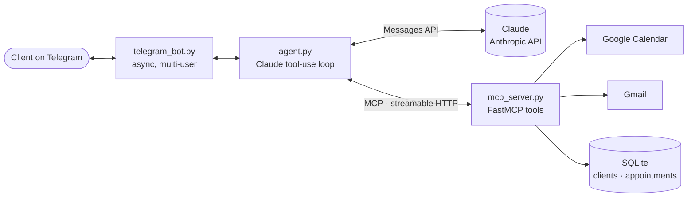
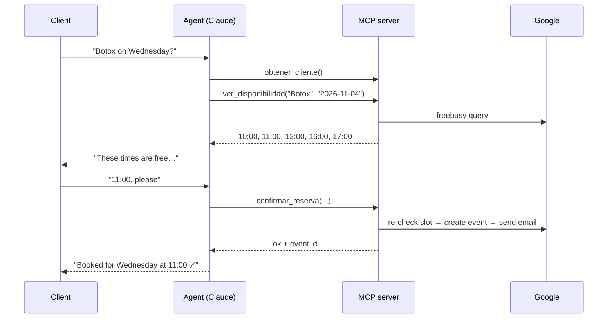

# Clinic Bot — AI appointment assistant on Telegram

A Telegram assistant for an aesthetic clinic that answers questions about treatments and **books, reschedules and cancels appointments** in natural language. It is powered by **Claude** (Anthropic) and talks to Google Calendar, Gmail and a SQLite database through its own **MCP server**.

[](https://github.com/rafasuarzz/Clinic_bot/actions/workflows/ci.yml)


<!-- Add a short GIF of a booking conversation here: docs/demo.gif -->

## What it does

- Answers questions about treatments (price, duration, indications, contraindications).
- Checks real availability in Google Calendar (45-minute slots, weekdays only).
- Books an appointment, creates the Calendar event and emails a confirmation.
- Reschedules or cancels an appointment (asking for the cancellation reason) and emails the change.
- Recognises returning clients, so they are never asked for their details twice.

## Architecture



The agent never has hard-coded tools: on every message it asks the MCP server for its tool list (`list_tools`) and converts the schemas for Claude. Each tool is defined **once**, on the server, and any MCP client (e.g. Claude Desktop) could use the same server.

### What happens when a client books



### MCP tools

| Tool | Purpose |
|---|---|
| `info_tratamiento` | Treatment details from the catalog |
| `ver_disponibilidad` | Free slots for a date (Google Calendar free/busy) |
| `confirmar_reserva` | Create the event, register client and appointment, send email |
| `modificar_cita` | Move an appointment to a new date/time and notify |
| `cancelar_cita` | Cancel with a reason and notify |
| `obtener_cliente` | Client details and upcoming appointments |

## Design decisions

- **The model cannot impersonate another client.** The `cliente_id` parameter is hidden from Claude's tool schemas and always injected by the bot with the sender's real Telegram ID, so a prompt injection cannot read or act on someone else's data.
- **Ownership is enforced server-side, too.** `modificar_cita` and `cancelar_cita` check that the appointment belongs to the client *before* touching Calendar, and return the same error for "not yours" and "does not exist" so event IDs cannot be probed.
- **No double bookings.** `confirmar_reserva` and `modificar_cita` re-check the slot right before writing to Calendar, in case it was taken during the conversation.
- **The server validates, not the model.** Dates in the past, weekends, malformed dates, slots outside opening hours and unknown treatments are rejected by the server with a clear `ToolError`, which Claude receives as a tool error and explains to the client.
- **GDPR-friendly consent.** Marketing consent is opt-in (off by default) and is never withdrawn by accident when a returning client books again.
- **Transactional storage.** Clients and appointments live in SQLite (foreign keys, WAL mode); a booking writes the client and the appointment in a single transaction.
- **Recoverable conversations.** If anything fails mid-turn (API error, refusal, too many steps), the turn is rolled back so the history never contains a tool call without its result.
- **Cost-aware.** Prompt caching reuses the system prompt, tool schemas and history across tool-use steps: a typical message costs about **$0.006** with Claude Sonnet 5.5. Model and reasoning effort are configurable.
- **Local-only server.** The MCP server binds to `127.0.0.1` by default because it has no authentication.

## Tech stack

Python 3.10 · [Anthropic SDK](https://github.com/anthropics/anthropic-sdk-python) (Claude Sonnet 5.5) · [FastMCP](https://gofastmcp.com) · python-telegram-bot · Google Calendar API · Gmail API · SQLite

## Project structure

```
├── telegram_bot.py            # Telegram interface (async, concurrent users)
├── agent.py                   # Claude tool-use loop, MCP client, identity injection
├── mcp_server.py              # MCP server: booking tools and business rules
├── google_api.py              # Google Calendar and Gmail access (OAuth)
├── db.py                      # SQLite data layer (clients, appointments)
├── settings.py                # Paths, opening hours and environment variables
├── config/
│   └── tratamientos.json      # Treatment catalog (editable)
├── scripts/
│   ├── autorizar_google.py    # One-time Google OAuth authorization
│   └── migrar_json_a_sqlite.py# Migration from the legacy JSON storage
├── data/                      # Runtime files, git-ignored (DB, OAuth token, credentials)
├── requirements.txt
├── requirements-dev.txt       # + ruff (lint and format, configured in pyproject.toml)
└── .env.example
```

## Getting started

### Prerequisites

- Python 3.10+
- A Telegram bot token from [@BotFather](https://t.me/BotFather)
- An [Anthropic API key](https://platform.claude.com)
- A Google Cloud project with the **Google Calendar API** and **Gmail API** enabled, and an OAuth client of type *Desktop app*

### 1. Install

```bash
git clone https://github.com/rafasuarzz/Clinic_bot.git
cd Clinic_bot
python3 -m venv .venv
source .venv/bin/activate
pip install -r requirements.txt
```

### 2. Configure

```bash
cp .env.example .env   # then fill in TELEGRAM_BOT_TOKEN and ANTHROPIC_API_KEY
```

Download your Google OAuth client JSON and save it as `data/credentials.json`.

### 3. Authorize Google (once)

```bash
python scripts/autorizar_google.py
```

A browser window opens to grant Calendar and Gmail access; the token is saved to `data/token.pickle`.

### 4. Run

In two terminals:

```bash
python mcp_server.py
```

```bash
python telegram_bot.py
```

Then open your bot in Telegram and say hi. In VS Code you can also use the **Servidor + Bot** launch configuration.

## Configuration

| Variable | Default | Description |
|---|---|---|
| `TELEGRAM_BOT_TOKEN` | — | Telegram bot token (required) |
| `ANTHROPIC_API_KEY` | — | Anthropic API key (required) |
| `CLINICA_MODEL` | `claude-sonnet-5-5` | Claude model |
| `CLINICA_EFFORT` | `low` | Reasoning effort: `low`, `medium`, `high` |
| `GMAIL_FROM` | authorized account | Sender address for emails |
| `MCP_PORT` | `3333` | MCP server port |
| `CLINICA_DB` | `data/clinica.db` | SQLite database path |

Opening hours and slot length are set in `settings.py`; the treatment catalog in `config/tratamientos.json`.

## Testing

The test suite runs fully offline: every test gets a fresh temporary SQLite database, and Google Calendar and Gmail are replaced by an in-memory fake. MCP tools are exercised through a real MCP client connected in memory, and the agent loop runs against a scripted fake of Claude, so no API calls or credentials are needed.

```bash
pip install -r requirements-dev.txt
pytest          # 61 tests: business rules, data layer, MCP tools, security, agent loop
ruff check .    # lint
ruff format .   # format
```

GitHub Actions runs lint, format check and tests on Python 3.10 and 3.12 for every push and pull request.
